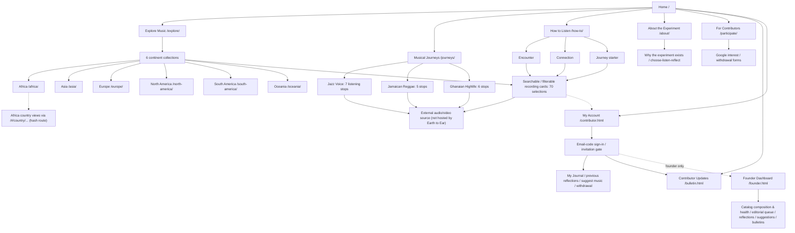
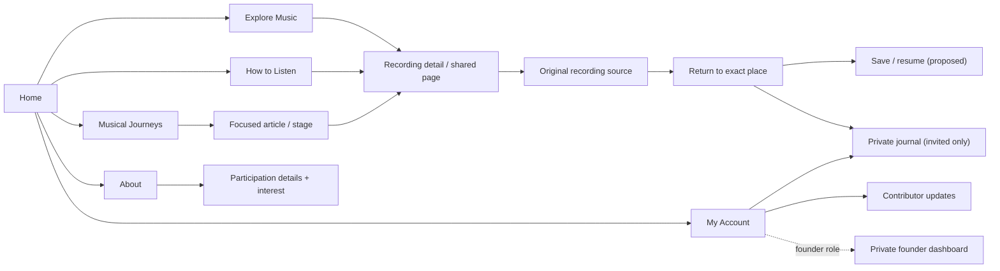

# Earth to Ear — Site Map & UI/UX Architecture Review

**Review date:** November 11, 2026  
**Status:** *Read-only review and recommendations*. No production UX changes are made by this document.  
**Basis:** Current `crespen/world-music-experiment` GitHub repository on its default branch, including the public XML sitemap, public HTML wrappers, `assets/site.js`, `assets/site.css`, the separate About / Musical Journeys pages, the signed-in journal, bulletin and founder dashboard. The prior database verification recorded **70 active music selections and 70 private journal-registered recordings**. External standard: W3C WCAG 2.2, Nielsen Norman Group heuristics, and Core Web Vitals.

**Limit:** A live viewport/browser audit of `earthtoear.com`, real music playback, actual screen-reader operation, mobile device navigation, and Core Web Vitals measurement could **not** be completed in this review. Repo code proves implementation but not live deployment or visual/compliance conformance. Treat untested issues as risks, not confirmed failures.

## Executive assessment

**Compelling editorial foundation; fragmented navigation and incomplete listener continuity.** Earth to Ear already has the ingredients of a differentiated product: public global listening, a welcoming first-visit guide, thoughtful historical journeys, secure contributor research, and founder curation. It is **not yet appropriate to call it a mature, standards-verified UX**. The largest risk isn't missing features or insufficient recordings; it is that the listener's path across pages and third-party audio providers has not been designed end-to-end.

**Highest-return improvements:** (1) one consistent public header/footer and information architecture, (2) a direct and resumable recording → original-source → Earth to Ear flow, (3) more effective discovery/filtering of a growing catalog, and (4) accessibility/performance QA before an Android PWA launch.

## A. Actual current site map

### Route inventory and status

| Destination | URL / implementation | Public or protected? | Function in listener experience |
|---|---|---|---|
| Home | `/` | Public | Hero, first-visit dialog, original-source listening strip, featured music, continent map and introduction |
| How to Listen | `/how-to/` | Public | Encounter / Connection / Journey; examples link into catalog |
| Explore | `/explore/` | Public | All recordings grouped by continent; text search, musical approach filter, source / journal actions |
| Continent collections | `/africa/`, `/asia/`, `/europe/`, `/north-america/`, `/south-america/`, `/oceania/` | Public | Regional catalog views |
| Country views | `/#/country/<country>` for Africa | Public, client-side hash route | Only Africa has this country-level special route; not separate canonical pages |
| Musical Journeys | `/journeys/` | Public | Three arcs, all on one long static page; 18 individual original-source links |
| About | `/about/` | Public | Philosophy and three-step process; independent page implementation |
| For Contributors | `/participate/` | Public | Interest / withdrawal and explanation of invitation |
| Contributor Updates | `/bulletin.html` | Signed-in contributor access for actual bulletin data | Milestones, project announcements, personal updates; appears in public navigation |
| My Account / Journal | `/contributor.html` | Public sign-in shell; protected data/actions | Email sign-in, invitations/registration, current and previous private reflections, suggestions, withdrawal |
| Founder Dashboard | `/founder.html` | Founder-authorized | Catalog composition, editorial queue, link health, submissions, qualitative activity, bulletin management |
| Crossroads, Discoveries, Suggest routes | `/#/crossroads`, `/#/discoveries`, `/#/suggest` | Implemented as client-side route branches, but not primary menu destinations or public sitemap URLs | Future/conceptual research paths and a legacy suggestion experience; not recommended for top-level navigation |

**XML search-engine sitemap:** `/sitemap.xml` already lists **12 canonical public URLs**: home, About, For Contributors, Explore, How to Listen, Musical Journeys and six continents. This machine-facing sitemap is distinct from the human-facing architectural map above. It appropriately omits private journal, bulletin and founder pages. The hash-based country routes are not indexed as independent pages.

## B. Navigation structure as implemented

The `assets/site.js` template is used across the home, Explore, continent and other dynamic pages. It shows:

`Explore Music · Musical Journeys · How to Listen · About the Experiment · For Contributors · Contributor Updates · My Account`

A separate **About** template has its own nav, **Musical Journeys** has a different brand/header and a “Home / My Journal” nav, the contributor page has a small portal-specific nav, and the founder and bulletin pages use still different headers. This is real code divergence, not just visual speculation.

### Main listener journeys

**Discovery** — Homepage / guide → Explore or continent → recording card → original provider (new tab) → listener must find a way back.  
**Curated education** — Homepage → Musical Journeys → one of three arcs → a succession of source links and album/artist blurbs → more source links.  
**Research participation** — Recording card → My Journal link → contributor email sign-in if needed → select/confirm recording → journal → previous reflections.  
**Founder operations** — Founder sign-in → dashboard → catalog insights/editorial/research; separate private tasks.

### What works already

- Meaningful public content exists on all **six continents**; listening is not gated.
- How to Listen presents **three distinct motivations**, with a dismissible first-visit welcome on home.
- Musical Journeys combines meaningful history and **direct source-linked recordings**.
- The original-source model respects recording ownership without pretending to host artist audio.
- Journal submissions use an inviting open reflection followed by **optional** prompts.
- The founder has legitimate catalog/quality and journal review tools.
- Public site has semantic main content and a responsive stylesheet, and most recording links are normal HTML anchors rather than mouse-only UI.
- The site already has a public SEO sitemap with canonical high-level pages.

## C. Heuristic evaluation

| Dimension | Judgment from inspected code | Main observation |
|---|---|---|
| Information architecture | **Needs work** | Different navs, unequal page hierarchy, private contributor updates in public nav |
| Findability | **Partial** | Global text search + 4 recording-type filter values, but 70 full-size cards and no country/style/instrument/favorites filters |
| First-visit clarity | **Promising** | Encounter / Connection / Journey is clear; immediate first-home modal may interrupt visitors |
| Task completion | **Partial** | Provider links and journal deep-links function conceptually; no deliberate return-to-exact-recording or resume cue |
| Consistency / orientation | **Needs work** | Independent headers and footers; journey does not look like the same navigational shell |
| Accessibility | **Risks identified; not certified** | Mobile nav toggle lacks a programmatic expanded state; no explicit skip-link found; all contrast, focus, screen reader and touch tests pending |
| Feedback and error handling | **Needs work** | Public dynamic app waits for music catalog before rendering any route; catalog failure replaces even independent informational content with a generic error |
| Performance / mobile | **Untested** | Responsive CSS exists, but widths 721–960 px, content weight, layout shift and real metrics haven't been measured |
| Trust and privacy | **Promising with disclosure gap** | Public listening/private journal distinction exists; public nav can send anonymous visitors into a private bulletin |
| Returning-listener value | **Missing key feature** | No Saved Listening, resumption, continued journey or shareable standalone recording page yet |

This is a **heuristic code review**, not an accessibility certification or statistically validated usability study. It is informed by [Nielsen Norman Group’s usability heuristics](https://www.nngroup.com/articles/ten-usability-heuristics/) and [WCAG 2.2](https://www.w3.org/TR/WCAG22/).

## D. Prioritized improvement backlog

### P0 — Fix structure and access before expansion

**P0.1 · One design-system navigation:** Use the **same approved masthead, links, active-state, footer and mobile behavior** throughout public Home, Explore, continent, About, How to Listen and Musical Journeys. The account portal may have a simpler authenticated subnav but must have a reliable path back to browsing. Preserve the founder dashboard's privacy.

**P0.2 · Simplify the public menu:** Recommended main destinations:
`Explore Music | Musical Journeys | How to Listen | About | My Account`. Put **For Contributors** within About and in an appropriate contributor CTA, and **Contributor Updates** inside My Account. Do not remove participation functionality; remove navigation clutter and misleading protected destinations.

**P0.3 · Fix catalog-failure resilience:** In `assets/site.js`, initial render relies on `loadCatalog()`; the catch block replaces the whole app with an unavailable-library message. Make About, How to Listen, participation explanation and basic navigation work when catalog retrieval fails. Add a local error panel in the specific music area, retry controls and clear loading skeletons.

**P0.4 · Accessibility foundation:** Add a visible-on-focus “Skip to content” mechanism; give mobile menu button accurate `aria-expanded` and `aria-controls`; verify keyboard Escape/focus restoration for modal and mobile menu; evaluate status updates using polite live regions. Meet **WCAG 2.2 AA** where applicable: contrast ≥4.5:1 for ordinary text (except defined exemptions), visible focus, keyboard access, logical heading order and ≥24×24 CSS px target size or appropriate spacing/equivalent exceptions. A code search alone does **not** prove conformance or violations. [W3C target size](https://www.w3.org/TR/WCAG22/#target-size-minimum), [W3C contrast](https://www.w3.org/WAI/WCAG22/Understanding/contrast-minimum), [W3C disclosure pattern](https://www.w3.org/WAI/ARIA/apg/patterns/disclosure/).

### P1 — Complete the actual listening loop

**P1.1 · Recording detail/anchor:** Give every recording a canonical, shareable landing view with title, performer, country/cultural context, original-provider information, what-to-listen-for note, and source link. Currently `/explore/?recording=ID` primarily **prefills a search** rather than giving a unique recording page/meta description. Avoid generating 70 generic pages; use one reusable template and deep-linkable URLs.

**P1.2 · Return from provider:** Before opening the source, preserve recording/journey position. On return, offer **“Continue where you left off,” “Hear this again,” “Save for later,”** and for invited contributors, **“Reflect in My Journal.”** A progress chip is an aid to navigation, not a gamification score. Test Android where original music may open another app.

**P1.3 · Reduce catalog scanning:** Keep a visually rich featured area, but make the full 70+ listing more scannable. Add useful faceted filters (continent/country, approach/genre/style, era/recording type, performer/instrument where data support exists). Label `period` filter accurately—currently called an “era” control even though categories include “Living traditions” and “Contemporary.” Provide a visible result count, clear-filters control and search-empty next step. Don't claim a searchable attribute unless the catalog consistently records it.

**P1.4 · Bring arcs out of one long page:** Give Jazz Voice, Jamaican Reggae and Ghanaian Highlife independently shareable article URLs, each with visible previous/next stop, progress cue, and a compact bibliography/artist-voice segment. The present `/journeys/` page has **18 stops on one page**; its index anchors help but content length and scroll return behavior need improvement.

### P2 — Deepen distinctiveness, not clutter

**P2.1 · Saved Listening:** Implement a voluntary **Listen Later** shelf and "Resume Journey," initially browser-local for anonymous visitors. If cross-device sync is desirable, design a **general listener account** separately from invitation-only research participation; don't silently merge them.

**P2.2 · Revisit-first recommendations:** When a listener returns, show “Continue,” “Listen again,” and “Try a related performance” rather than ranking recordings or gamifying activity.

**P2.3 · Invitation flow:** Distinguish **public listener**, **interested applicant**, **registered research contributor**, and **founder**. Make it clear that My Journal, bulletin and research entry are protected, while all music is public.

**P2.4 · Editorial architecture:** Give Musical Journeys consistent categories, credits, archival/source notes, careful first-person artist context and related journeys. Consider dedicated source link-status and playback-type badges where provider playback is available. Do not imply a recording is fully free merely because a provider page exists.

**P2.5 · URL / discovery strategy:** Individual recording and journey URLs should have meaningful titles, metadata and share previews. Hash-based African country views and exploratory routes are not automatically standalone search-engine pages. Do not add private pages to the XML sitemap.

### P3 — Strengthen production confidence

**P3.1 · Real mobile audit:** Test 360/390/768/820/1024/1440 px widths; watch for navigation crowding between the current 720 and 960 CSS breakpoints, oversize masthead and tap targets. Test Chrome Android, Samsung Internet, Safari iPhone, desktop Chrome/Firefox, portrait/landscape and zoom to 200% / 400% as applicable.

**P3.2 · Screen-reader / keyboard test:** Keyboard-only journey from first-visit modal through a recording and back, including Escape behavior, visible focus, and announcements. Check NVDA/Chrome and TalkBack/Android. Test any audio player controls and ensure transcripts/alternatives for future media.

**P3.3 · Performance:** Measure real/mobile Core Web Vitals instead of guessing from source size. Target good **LCP ≤2.5 s**, **INP ≤200 ms**, **CLS ≤0.1** at the 75th percentile. [Google Search Console](https://support.google.com/webmasters/answer/9205520).

**P3.4 · PWA later:** Only after the listener flow is strong: add Android install manifest/icons, service-worker strategy and controlled offline states; neither installation nor app store packaging creates rights to stream offline copies of provider audio.

## E. Recommended next-generation navigation

**The key architectural difference:** The navigation directs people to an *experience*, and every playback path gives them a way back. The current site is organized mostly as a group of pages; the proposed version is organized as a repeatable listening journey.

## F. Acceptance tests before calling the UX “ready”

1. **First-time visitor:** Without explanation, can they identify what the project does and start a recording within ~30 seconds? Does the guide feel optional rather than obligatory?
2. **Public listener:** Can they find one unfamiliar recording by country or style and reach the original audio without signing in?
3. **Returning listener:** Can they return to the same source-linked recording or journey after switching out to YouTube or another audio host?
4. **Research contributor:** Can they find and complete My Journal from a selected recording without re-searching or losing context? Are past reflections intact?
5. **Mobile visitor:** Can they open and close menu, read text, choose recording, exit external provider and return without horizontal overflow or lost state?
6. **Keyboard and screen-reader:** Can they skip repeated navigation, understand expanded/collapsed controls and dialogs, and operate the full primary path?
7. **Reliability:** When Supabase catalog retrieval fails, can they still read About, How to Listen and contributor information?
8. **Editorial:** Are source links usable, performer credits clear, date of recording distinct from reissue/upload date, and guest/artist perspectives properly attributed?
9. **Findability:** Can they return to a shared recording link from outside the site, with its identity and context immediately apparent?
10. **Founder:** Can all 70 source records and journal associations be reviewed without exposing participant information publicly?

## G. Recommended execution sequence

**Sprint 1 (structure):** Agree on 5-item public navigation; unify public shell and role labeling; accessibility/availability fixes.  
**Sprint 2 (journey):** Reusable recording detail and return/resume mechanism; distinct shareable journey URLs.  
**Sprint 3 (discovery):** Catalog facets, scannable listings, saved listening test and measurement.  
**Sprint 4 (verification):** Real-user 5-person task observation, mobile + assistive-tech audits, Core Web Vitals, then PWA feasibility.

**No live pages were modified by this audit.** Proposed routes and controls in the second map are not yet built.
